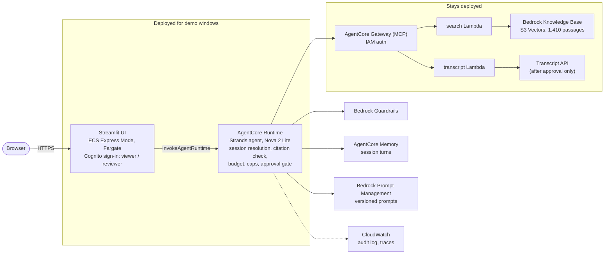

# Earnings Research Assistant

A chat assistant that answers questions about company earnings calls (what management said, why, and what they expect), cites the passages it used, and says so when a call didn't cover the question. Built on Amazon Bedrock AgentCore with Strands Agents, with each safeguard enforced in code and measured against a golden set.

> **Not investment advice.** It reports what management said on earnings calls. It gives no buy/sell/hold views or price targets, and refuses when asked. LLM answers can be wrong; every answer links the passages it is based on so they can be checked.

**Status:** a working, production-style demo, deployed on AWS for test and demo windows and torn down between them. Single user, no real traffic.

---

## What it does

Ask in plain language, and follow up the way you would with an analyst:

| You ask | The assistant |
|---|---|
| *What drove AMD's gross margin in Q2 2026?* | Searches that call only, answers, and lists the cited passages (speaker, call) |
| *And operating margin?* | Keeps the company and quarter from the conversation |
| *What did they say about gross margin?* (no company yet) | *"Which company do you mean? I have calls for AMD, RIVN, ROOT, META, CRDO and NBIS."* |
| *Did Rivian announce a dividend on its Q2 2026 call?* | Says the call didn't discuss it, and cites nothing |
| *Should I buy AMD?* | *"I only report what management said on earnings calls. I can't give buy, sell or hold recommendations, price targets or investment advice…"* |
| *What did NVIDIA say about data center demand in Q3 2026?* (outside the corpus) | *"NVDA isn't in my corpus. I can fetch the transcript of its Q3 2026 call from an external source, for this question only, once a reviewer approves."* A reviewer approves or declines in the UI; nothing is fetched before that |

It answers over a **fixed corpus of 24 calls** (6 companies × 4 quarters), so every evaluation run sees the same data. Live answers aren't reproduced here because the transcript provider's terms don't allow redistributing them.

## How it stays honest

Rules that can be checked in code are enforced in code, not left to the prompt. Several began as prompt rules that the model ignored during evaluation.

| Safeguard | How |
|---|---|
| **Citations are verified** | Each answer cites passage IDs, and code checks that every cited ID was returned by the search in that turn. In the last two evaluation runs, all 28 answers passed in each, and none cited a passage the search hadn't returned |
| **Says "not discussed" instead of guessing** | Four golden-set questions ask about topics the calls never covered. Since the search limit moved into code, all 4 are declined in every run |
| **Investment advice refused** | Bedrock Guardrails: a denied topic, prompt-attack detection, PII masking on question and answer, and a grounding score that flags answers drifting from their cited passages. A follow-up like *"What about Meta?"* is re-checked with the previous question, so it isn't mistaken for an advice request |
| **Company and quarter resolved in code** | Follow-ups, missing companies, quarters not in the corpus and out-of-corpus companies get fixed replies before the model runs. That costs no tokens and the model can't get it wrong |
| **Human approval for the one risky action** | Fetching a call from outside the corpus calls an external API with unvetted content. It needs a user in the `reviewer` group, checked on the server, and someone can't approve their own request. The fetched call answers that one question and is never added to the corpus |
| **Bounded cost** | A per-run budget (model calls, tokens, tool calls) with a hard stop. A search limit in code. Caps of 30 turns per session and 100 per day in a DynamoDB counter, enforced in the runtime, not the browser |
| **Audit log** | One JSON record per turn: who (role, session), the question as masked, each search and the passages it returned, citations and their check, guardrail results, approval decision and who made it, model and prompt version, tokens, latency. Never raw PII, passage text or credentials. Kept 30 days |
| **Least privilege** | The UI may only invoke the one runtime. The runtime reaches the tools only through the MCP Gateway, which may invoke only its two Lambdas. Policies are asserted in offline CDK tests |

## Measured results

Every change was measured before it was kept, on a **golden set of 30 answerable + 4 unanswerable questions** with expected answers and the exact transcript turn behind each. Retrieval, grounding and task correctness are scored separately; abstention is scored on the unanswerable ones. Agent: Amazon Nova 2 Lite; judge: Amazon Nova Pro. **Two runs per change, shown as a range. These show direction, not accuracy rates.**

| Change | Task correct (of 30) | Grounded (of 30) | Unanswerable declined (of 4) |
|---|---|---|---|
| Retrieval + citation check, first prompt | 16–18 | 22–23 | 2 (the other 2 ran out of budget) |
| Prompt v2: search with the question's words, answer as soon as covered | 19–20 | 25–26 | 1–2 |
| Search limit enforced in code (prompt unchanged) | 19–20 | 26 | **4, 4** |
| Prompt v3: follow-ups, comparisons, guidance wording | 21 | 23–25 | 4, 4 |
| Tools moved behind an MCP Gateway (no logic change) | 21 | 25 | 4, 4 |

The search limit in code also cut total tokens by about 22%. A typical answer uses about 5,000 tokens.

**Conversations:** 17 scripted multi-turn conversations cover seven flows: answer, clarify, follow-up, advice refusal, unknown company, approval and "not discussed". Scoring is done in code.

| Version | Conversations passed | Turns passed | Wrongly refused |
|---|---|---|---|
| First multi-turn baseline (13 conversations) | 9 of 13 | 21 of 26 | 0 |
| Prompt v3 + clarifying question in code | 11–12 of 13 | 24–25 of 26 | 0 |
| All 7 flows incl. approval, via MCP Gateway | 16 of 17 | 40 of 41 | 0 |

**Retrieval:** filtering by company and quarter puts the right passage in the top 3 for 29 of 30 questions, against 20 unfiltered. Abbreviations like "capex" are expanded in code, which raised on-topic passages in the top 5 from 64 to 92 of 125 term × call pairs.

**A trade-off measured, not hidden:** an earlier version that reads the whole call for every question got 24 of 30 correct, against 21 for retrieval. But it answered 2 of the 4 unanswerable questions anyway, used about 2.7× the tokens (13.6K vs 5.0K median), and cites nothing checkable.

## Problems found and fixed

A few of the real problems this process caught:

- **The model ignored rules in the prompt.** Told to search at most twice, Nova kept trying keyword variants until the budget ran out, and never said "not discussed". The limit moved into code: unanswerable questions went from 2 declined to 4 of 4, with 22% fewer tokens. A "which company?" prompt rule was ignored the same way. The clarifying question moved into code, and that flow went from 1 of 3 to 3 of 3 conversations.
- **"capex" found nothing.** The first live run said capital expenditure wasn't discussed, though the CFO covered it. The embedding search missed the abbreviation. Measured over 16 abbreviations, the search now appends the full phrase, and the agent found the topic in 8 of 10 abbreviation questions instead of 3–4.
- **A follow-up was blocked as investment advice.** On its own, *"What about Meta?"* looked like an advice request to the guardrail. Fixed by checking it again with the previous question in front. A real advice follow-up is still blocked.
- **Session memory kept raw personal data.** An email typed into the chat was masked in the audit log but stored raw in session memory. Now every store takes the question from one place, after masking.
- **Approval stored the wrong question.** After *"Which quarter?" → "Q3 2026"*, the fetch request held "Q3 2026" as the question. Offline tests had always named the quarter in the first message. Now the earlier question is stored. Lesson: test the multi-turn path a feature will actually be used through.

## Architecture

- **Retrieval for questions, full transcript only for approved fetches.** Retrieval keeps each turn to about 5K tokens, makes cross-quarter questions possible, and gives passage IDs that can be checked. A fetched out-of-corpus call is read whole for one question.
- **MCP only carries the tool calls.** Tools are reachable over a standard protocol and reusable by another agent. The search limit, abbreviation expansion, citation ledger and approval gate stay in agent code, so the model never calls a Gateway tool directly. Cost of the extra hop: about 100 ms per search.
- **Model is configuration.** Changing `model_id` in `infra/cdk.json` is the whole switch, and the IAM role follows it.
- **Infrastructure as code:** Python CDK, 10 stacks with separate lifetimes. The runtime and UI are destroyed after a demo while the Knowledge Base, Gateway, Guardrail, prompts, audit log and Cognito stay up for cents a month. Every log group expires.

## Engineering practice

- **Tests:** 458 offline tests (fake model, CDK policy assertions, no AWS) run in GitHub Actions on every pull request.
- **Workflow:** one branch and pull request per change. A change that alters behaviour carries its before/after numbers in the PR.
- **Evaluation harness:** golden set, multi-turn set, retrieval and guardrail evals. Each result is saved with date, model id, git commit and prompt hash (`eval/results/`).
- **Design first:** the conversation design ([docs/conversation_design.md](docs/conversation_design.md)) sets persona, the seven flows and the decisions behind them before they were built.
- **Reproducible:** pinned dependencies (`uv.lock`), corpus hashes, and a how-to for building your own golden set ([docs/golden_set.md](docs/golden_set.md)).

**Stack:** Python 3.12 · Strands Agents · Amazon Bedrock (Nova 2 Lite, Knowledge Bases, Guardrails, Prompt Management) · AgentCore (Runtime, Memory, Gateway/MCP, Observability) · Lambda · DynamoDB · S3 Vectors · Cognito · ECS Express Mode on Fargate · CodeBuild · CloudWatch · AWS CDK (Python) · Streamlit · pytest · GitHub Actions

## Known limitations

- **Small evaluation set:** 34 questions and 17 conversations, two runs per change. Differences of one or two answers are within run-to-run variation.
- **Long passages:** a figure buried in a long CFO passage can be missed by every search wording. Hybrid keyword + vector search would help, but S3 Vectors has no keyword search.
- **Comparisons across quarters** ("How did that compare with the quarter before?") still fail in the multi-turn set: the model searches without the quarter.
- **Fetched answers:**
  - Grounding is checked against the verified quote only, not the whole fetched call.
  - The quarter label is the company's fiscal quarter, so a fiscal "Q3 2026" may be a call held in 2025. The UI shows the call date.
- **Fixed reply texts:** the advice refusal is one fixed message. Sign-out ends on a Cognito error page, because Streamlit and Cognito use different logout parameters.
- **Single user:** used only by its author. The transcript provider's terms would require a paid plan to show its data to others.

## Repository

| Folder | Contents |
|---|---|
| `agent/` | The assistant: `serve.py` (runtime entrypoint), `answer.py`, `session.py` (company and quarter resolution), `citations.py`, `guard.py`, `approvals.py`, `audit.py`, `caps.py`, `gateway.py` |
| `ui/` | Streamlit chat and reviewer page |
| `search_lambda/`, `tool_lambda/` | The two MCP tools: passage search, transcript fetch |
| `infra/` | Python CDK stacks |
| `eval/` | Golden set, multi-turn set, harnesses, results |
| `corpus/` | Call list, hashes, word lists (no transcript text) |
| `tests/` | Offline test suite |
| `docs/` | Conversation design, golden-set guide, [how to run it](docs/running.md) |

To reproduce it in your own AWS account, see [docs/running.md](docs/running.md). The v1 agent (one structured brief per call) is kept in `agent/main.py`, tag `v1.0`.

## License

MIT
