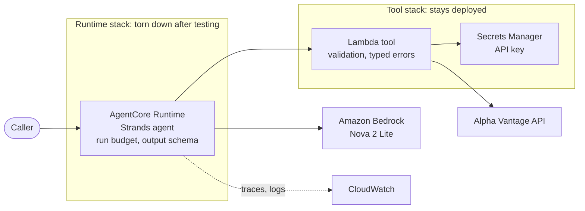
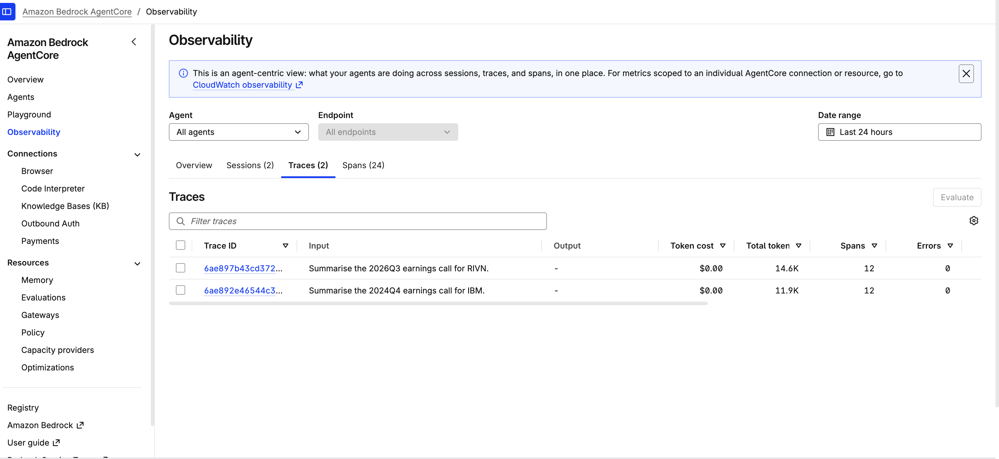
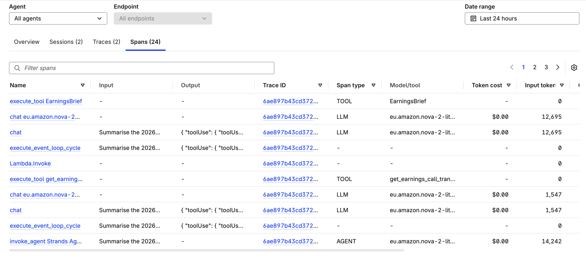

# Earnings Research Agent

A Strands Agents agent, deployed on Amazon Bedrock AgentCore Runtime, that reads a company's earnings call through a Lambda-backed market-data tool and returns the key points, reasons and assumptions as schema-validated JSON.

> **Status:** deployed and tested on AgentCore Runtime, then torn down to avoid cost. Every step below is reproducible in your own AWS account.
>
> **Not investment advice.** This is a research aid. It produces no buy/sell recommendations or price targets, and LLM-generated financial analysis can be wrong. Check anything you rely on against the transcript.

## Architecture



| Folder | Contents |
|---|---|
| `agent/` | The Strands agent: entrypoint, run budget, output schema, tool wrapper |
| `tool_lambda/` | The Lambda tool |
| `infra/` | Python CDK: one stack for the tool, one for the runtime |
| `scripts/` | Agent bundle build and one-time trace setup |
| `tests/` | Offline tests: a scripted fake model and CDK assertions, no AWS needed |

The two stacks have different lifetimes, so the runtime can be destroyed while the tool stays. Both are Python, using the CDK `Runtime` construct. The AgentCore CLI generates a TypeScript CDK app, and one IaC language was worth a small build script.

## Safeguards

| Safeguard | Where | Why |
|---|---|---|
| HTTP timeout derived from the Lambda's remaining time, minus a margin | `tool_lambda/handler.py` | A slow upstream returns a typed `timeout` error to the agent instead of the Lambda timing out |
| Upstream errors mapped to typed, retryable-or-not results | `tool_lambda/handler.py` | Alpha Vantage reports rate limits with HTTP 200 and a message; those must not reach the model as data |
| Transcript capped at 100,000 characters | `tool_lambda/handler.py` | Bounds the tokens a single tool call can add, while normal calls are read in full |
| Soft stop: tool calls past the limit are cancelled with an instruction to answer | `agent/budget.py` | Lets the model finish with what it has |
| Hard stop: model calls and tokens; further model calls are cancelled | `agent/budget.py` | A ceiling that doesn't depend on the model obeying a message |
| Output validated against a Pydantic schema | `agent/schema.py` | A malformed answer fails loudly instead of parsing into something plausible |
| Least-privilege runtime role | `infra/runtime_stack.py` | The runtime can invoke this one function and this one model, tested offline in `tests/test_infra.py`. Observability permissions come from the CDK construct and are broader |
| No API keys in code, template or repo | Secrets Manager | — |

The budget is tested end to end with a scripted model that calls the tool forever (`tests/test_agent_budget.py`).

## Run it

**Prerequisites:** Python 3.12, Node.js (for the CDK CLI), AWS CLI with a profile for your own account, an [Alpha Vantage](https://www.alphavantage.co/) API key, and access to a Bedrock model in your chosen region. The dev container in `.devcontainer/` provides the tools.

```bash
python -m venv .venv && source .venv/bin/activate
pip install -r requirements-dev.txt
pytest -q                                 # offline, no AWS needed
scripts/build_agent.sh                    # the CDK app needs build/agent to exist
```

The build targets Linux on arm64 and Python 3.12, the runtime's platform, whatever machine it runs on.

**1. Deploy the tool**

```bash
cd infra
npx cdk bootstrap                         # once per account and region
npx cdk deploy EarningsResearchAgentTool
aws secretsmanager put-secret-value --secret-id <SecretArn> --secret-string '<your Alpha Vantage key>'
```

**2. Run the agent locally** against the deployed tool and Bedrock:

```bash
cd agent
export MODEL_ID=eu.amazon.nova-2-lite-v1:0   # or another Bedrock model or inference-profile id
export TOOL_FUNCTION_NAME=<ToolFunctionName output>
python run_local.py IBM 2024Q4
```

**3. Deploy to AgentCore Runtime.** Traces need CloudWatch Transaction Search, a one-time, account-wide setting. Wait for `ACTIVE` before deploying.

```bash
scripts/enable_transaction_search.sh
aws xray get-trace-segment-destination    # PENDING for some minutes, then ACTIVE
scripts/build_agent.sh                    # before every deploy
cd infra && npx cdk deploy EarningsResearchAgentRuntime
```

The model comes from `model_id` in `infra/cdk.json`. The role is scoped to that model, so changing it needs no code change. The inference profile and foundation model ARNs in `infra/runtime_stack.py` assume an EU profile.

**4. Invoke it.** Send this payload from the console (AgentCore → Playground), or with `invoke_agent_runtime` in boto3:

```json
{"ticker": "IBM", "quarter": "2024Q4"}
```

The response has a `status`, the `brief`, a `run` block of measurements, and any `error`. Each run uses one of Alpha Vantage's 25 free daily requests. Traces appear under AgentCore → Observability.

**5. Tear down**

```bash
cd infra
npx cdk destroy EarningsResearchAgentRuntime
aws logs describe-log-groups --log-group-name-prefix /aws/bedrock-agentcore/runtimes/
aws logs delete-log-group --log-group-name <each group listed>   # the stack doesn't own these
```

Transaction Search stays on. To undo it: `aws xray update-trace-segment-destination --destination XRay`.

## Measurements

Single runs on Nova 2 Lite in eu-central-1, so these show scale, not an average.

| Run | Where | Tokens (budget 40,000) | Model / tool calls | Agent latency |
|---|---|---|---|---|
| IBM 2024Q4, 3 of 31 segments, before the fix | Local | 5,227 | 2 / 1 | 9.2 s |
| IBM 2024Q4, full transcript | Local | 11,997 | 2 / 1 | 9.0 s |
| IBM 2024Q4, full transcript | Runtime | 11,917 | 2 / 1 | 6.9 s |
| RIVN 2026Q3 | Runtime | 14.6K | not recorded | not recorded |

Token counts agree between the agent's own run report and AgentCore observability. Observability displayed a token cost of `$0.00`, which is not a real figure.





Read the spans from the bottom up. Each model call appears twice because two libraries record it. The token jump between the two calls is the transcript being read.

## Output quality

All 15 claims of one IBM 2024Q4 brief were checked against the full transcript by hand. All were supported and every figure matched. That is one brief from one run, and it says nothing about other runs. The same brief showed real weaknesses:

- It wrote "Generated AI" for "generative AI".
- `assumptions` mostly repeats management's forecasts instead of what those forecasts rest on.
- Some `reasons` state results, not explanations, and a few items appear in two sections.

## Known limitations

- `speakers_cited` is model-written text that nothing checks. It once named a CFO whose remarks had been cut from the transcript.
- A budget stop was tested offline with a model that loops forever, not on the deployed runtime.
- Spans store full prompts and outputs in CloudWatch. Harmless for public transcripts, but set a retention period before using this with private data.
- The newest Anthropic models were not available to the test account, with their quotas at 0. Older Claude models worked. The deployed model is Amazon Nova. Changing model is a config edit.

## License

MIT
